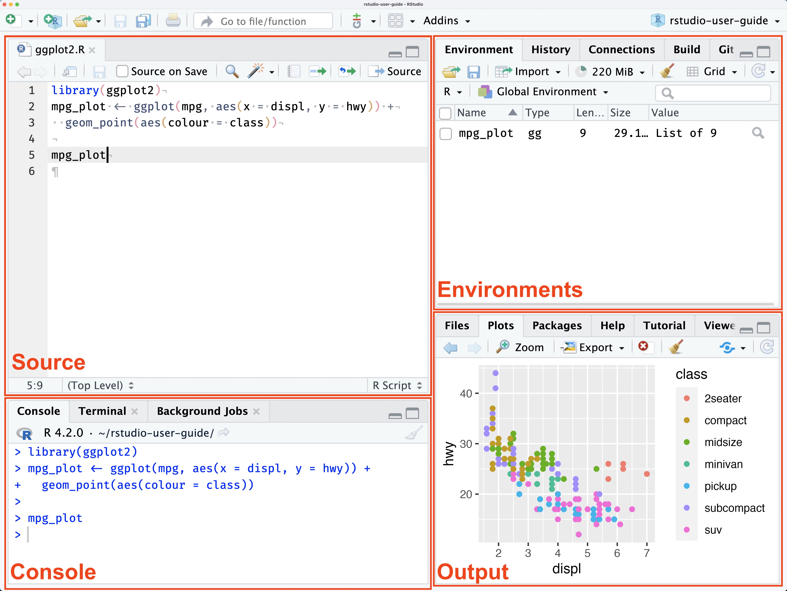

```{=html}
<!--
INSTRUCTOR NOTES (not rendered)
Source plan: Lesson_Plan_Blended_Accelerated.md (120 min, no slack).
Timing:  1 Welcome 0:05 | 2 Install 0:25 | 3 RStudio tour 0:35 | 4 Quarto 0:42
         Break 0:47 | 5 Variables & Types 1:02 | 6 Data Structures 1:17
         7 Operators 1:27 | 8 Functions 1:42 | 9 if/else 1:50 | 10 for 1:58 | 11 Wrap-up 2:00
Cut list if behind (in order): nested for loop -> Celsius practice to take-home
         -> else-if chain -> Text data type.
Riskiest segments: Install (use posit.cloud fallback early), Quarto (tell attendees
         NOT to render today), Functions practice, Data Structures indexing.
-->
```

# Welcome & Learning Outcomes

This is an **accelerated** session that covers material normally taught across two workshops. The pace will be brisk, and several topics are deliberately left out today. These topics are listed at the end of this notebook. They are covered in the full *Fundamentals* and *Loops & Functions* workshops.

By the end of this session, you will be able to:

1.  Install R and RStudio ✅
2.  Explain the difference between R and RStudio and navigate the RStudio environment
3.  Create variables and use basic data types and data structures (vectors, data frames)
4.  Use arithmetic and relational operators
5.  Write a user-defined function
6.  Write an `if` statement and a `for` loop

------------------------------------------------------------------------

# Install R & RStudio

You need **two** pieces of software, installed in this order:

- **R** is the programming language, the engine that actually runs your code.
- **RStudio** is the programming environment (IDE) that makes writing and running R code easier. RStudio needs R to already be installed.

## Step 1: Install R

1.  Go to CRAN: <https://cran.r-project.org/>
2.  Choose the download for your operating system:
    - **Windows:** "Download R for Windows" → "base" → download the installer.
    - **Mac:** "Download R for macOS" → pick the right build for your chip:
      - **Apple Silicon** (M1/M2/M3/M4): the `arm64` installer
      - **Intel** Macs: the `x86_64` installer
      - Not sure? Apple menu → **About This Mac** → look at "Chip" or "Processor".
3.  Run the installer and accept the default options.

## Step 2: Install RStudio Desktop

1.  Go to Posit: <https://posit.co/download/rstudio-desktop/>
2.  Download the free **RStudio Desktop** installer for your operating system.
3.  Run the installer and accept the default options.

## Step 3: Verify Your Install

Open **RStudio** (not R). The Console (lower left pane by default) should show a banner with your R version. Type the following in the Console and press Enter:

```{r}
#| label: verify-install

1 + 1
```

If you see `[1] 2`, you're all set!

> **Stuck?** If your laptop won't let you install software (e.g., no admin rights, or a blocked installer), raise your hand. You can follow along today in your browser using [Posit Cloud](https://posit.cloud/) and finish installing later.

------------------------------------------------------------------------

# R vs. RStudio: What's the Difference?

- R is an open-source programming language
  - used widely for data science and statistical analysis.
- Open-source means free to use
  - With access to many libraries and packages
  - Some tested more diligently than others
- RStudio is a programming environment
  - makes it easier to write and test scripts developed in R.

------------------------------------------------------------------------

# RStudio Environment

There are four main window panes in RStudio: the Source, the Console, the Environments and the Output Window. The default layout can be modified. Additional information on changing the layout can be found [here](https://docs.posit.co/ide/user/ide/guide/ui/ui-panes.html).

[{width="6in"}](https://docs.posit.co/ide/user/ide/guide/ui/ui-panes.html)

## Source Pane

- Shows open scripts, Notebooks and other files you are editing.
- The area where you can view data

## Console Pane

- Features 3 tabs by default:
  - Console Tab
    - Enter commands that run immediately
    - Good for testing
  - Terminal
    - lets you interact with your computer terminal
  - Background Jobs
    - provides information on "background" scripts which run in a separate dedicated R session.

## Environments Pane

- Environment
  - Provides info about variables defined during your session
- History
  - Shows all the commands you have run during your session
- Connections and Tutorial
  - beyond the scope of today's workshop

## Output Pane

- Files
  - shows your file directory
- Plots
  - this is where plots will show up when you generate them

```{r}
#| label: plot_tab_example
# Lets create a little plot
# create some data
data <- data.frame(a = c(72,41,54,36), b=c('East','West','North','South'))

# generate plot
barplot(data$a, 
        names.arg = data$b, 
        col="blue", 
        ylab="# of Regional Managers")

# function name
# function parameters
# return values

```

- Packages
  - Installed packages and loaded packages (check mark next to the name)
- Help
  - Your best friend!!
  - You can see the details about functions you want to use
  - use search bar in pane or type "?barplot" in console
- Viewer
  - Shows output for rendered notebooks

------------------------------------------------------------------------

# Notebooks & Scripts

Through RStudio, you can write and run R code in a couple of ways:

- **Scripts (.R):** only comments and code. The way most people start out.
- **Notebooks (.Rmd or .qmd):** text and code together, good for running small bits of code for a discrete task. We'll use **Quarto (.qmd)** notebooks, which are language-agnostic.

## Your Turn: Create a Quarto Document

From the menu, choose **File** → **New File** → **Quarto Document...**, give it a title, and click **Create**. This is your working notebook for the rest of today.

> **Please don't click "Render" today.** The first render can trigger extra package downloads. Running code chunks one at a time is all we need.

## Three Shortcuts Worth Knowing

| Description                | Windows & Linux | Mac          |
|----------------------------|-----------------|--------------|
| Run current line & advance | Ctrl+Enter      | Cmd+Return   |
| Insert code chunk          | Ctrl+Alt+I      | Cmd+Option+I |
| Insert assignment operator | Alt+-           | Option+-     |

: See [Posit's list of keybinds](https://support.posit.co/hc/en-us/articles/200711853-Keyboard-Shortcuts-in-the-RStudio-IDE) for more.

# Variables in R

Variables are named containers used to store information. What can we name them? Almost anything we want, according to the following rules:

- name has to start with a letter
- can contain any combination of letters, numbers and can include periods "."
- can't start with an underscore, "\_"
- are case sensitive
- can't be any of the reserved words in R

## What are R reserved words?

All programming languages have reserved words. These are words that have a specific meaning to the language itself. Some examples in R include:

- TRUE
- FALSE
- NULL
- if

You can see the reserved words in R by typing `?reserved` at the console prompt.

## Will it Variable?

For a variable to be useful, you must give it a value. To set a variable to a value, you use the assignment operator. In R, to assign a value to a variable we use "\<-".

The code box below shows some example variables. Use the arrow to the right of the code box to run the code.

```{r}
#| label: set-variables

# Set some variables:
wolf.name <- "Smiley"
wolf.age <- 5

# What happens when you try to use one of the reserved words listed above? Uncomment the line below. Notice: the color of the keyword and the snarky white x in the red (scary!!) circle. This is screaming "Don't do it!" But, by all means do it anyway and see what happens
# if <- 5

# Note how your computer didn't immediately combust into flames. As you are learning, feel free to try things out to see what happens. If R starts acting weird, you can always restart your Session, Restart RStudio, or even restart your computer. The first two will usually do the trick. Save your work as you go and you should be fine!

# See the variable value
print(wolf.name)
print(wolf.age)
```

## I Digress ...

In most programming languages, you use "=" as the assignment operator. While R lets you use "=", the convention is to use "\<-", a holdover from S, the language R is derived from. R programmers have feelings about this. Welcome to the club!

------------------------------------------------------------------------

# Data Types

Data Types

- are categories of data
- dictate how much space a variable takes, how it is handled as input and output, and how you can use it

We'll talk about 3 main data types today:

- Numeric
- Text
- Logical or Boolean

## Numeric

Numeric values are exactly what they sound like: numbers. In R, when you store a number it is loaded as a `double` (decimal) regardless of whether it has a decimal point or not. Most of the time you don't have to worry about whether a number is an integer or a double.

```{r}
#| label: numeric-type

# Create some variables and set them to numeric values
numWolves  <-  5
pctWolves <-  .20 # decimal, double, float(ing point)


# Add a decimal place to numWolves
numWolves <- 5.0

print(numWolves)
print(typeof(numWolves))
print(as.double(numWolves))
```

## Text

Run the code in the block below. What data type does R see string data as? Hint: run the last line!!

```{r}
#| label: text-type

# Some text examples

wolf.name <- "Scruffy"
print(wolf.name)

wolf.initial <- "D"
print(wolf.initial)

wolf.fullName <- "Scruffy D. Howl"

wolf.faveArtist <- "Prince"
print(wolf.faveArtist)
print(typeof(wolf.faveArtist))


```

### Storing Sentences

When dealing with longer sentences, it is important to keep track of double- and single-quotes.

```{r}
#| label: text-quotes

# You can use single quotes to surround a string
wolfQuote1 <- 'He had learned well the law of club and fang.'
print(wolfQuote1)

# You can nest double and single quotes.
wolfQuote2 <- "'You poor devil,' said John Thornton, and Buck licked his hand."
print(wolfQuote2)

# Notice what happens when you switch the single and double quotes
wolfQuote3 <- '"You poor devil," said John Thornton, and Buck licked his hand.'
print(wolfQuote3)
```

## Logical

A Boolean value is one that can take one of two values. In R, these are represented using the "logical" data type, which takes the value TRUE (1) or FALSE (0). It is good for setting flags and creating indices to subset data.

{width="6in"}

```{r}
#| label: logical-examples

# Example of boolean variables based on picture
isAlive <- FALSE
isWolf.1 <- TRUE

print(isWolf.1)
print(isAlive)

# What should we set isWolf.2 to: TRUE or FALSE?
```

Logical values are used ubiquitously in programming, particularly for program control. You'll see them in action with relational operators and `if` statements shortly.

------------------------------------------------------------------------

# Break (5 min)

**Checkpoint:** R and RStudio installed, a blank Quarto document open, you can run a code chunk.

------------------------------------------------------------------------

# Data Structures

Data structures are programming structures that allow storage of multiple values. Today we'll explore two widely-used ones:

- vectors
- data frames

There are two aspects of using data structures:

- how to create them; and,
- how to access the data in them.

## Vectors

Vectors store data in one dimension. They allow only one data type.

### How to Create Vectors

```{r}
#| label: vector-examples

# EXAMPLES OF HOW TO CREATE VECTORS
# (Single Data Type)

# Numeric
# Since R sees integers and decimal data as double, vectors can contain both
num.vec <- c(10, 4.5, 7, 12.2, 3.0)
print(num.vec)
print(typeof(num.vec))

# Examples using other data types
txt.vec <- c("Talley", "SAS Hall", "Hunt Library")
log.vec <- c(TRUE, FALSE, TRUE, TRUE)

```

Vectors only store one data type...really, really! But, what happens if you mix data types?

```{r}
#| label: mixed-data-type-vec

# Let's store some info about a pet cat named Fluffy: name, weight, isFemale and age
mixed.vec <- c("Fluffy", 12.0, TRUE, 2) # so far so good
print(mixed.vec) # oops...
```

While R will let you pass different types of data to a vector, it will convert all values to a single type. Remove "Fluffy" from the vector above and look at its data type again. R sets the single type to one that makes the most sense for the set of items in the vector.

### Accessing Data in Vectors

Elements in a vector can be accessed using an index inside square brackets.

```{r}
#| label: access-data-in-vectors

num.vec <- c(10, 4.5, 7, 12.2, 3.0)

# extract the 3rd value in num.vec
num.vec[3]

# extract the second through fourth values from num.vec
num.vec[2:4]

# extract the first, third and fifth (non-contiguous) values from num.vec
idx <- c(1, 3, 5) # idx is a vector of indices
num.vec[idx]

# what about: 
# num.vec[6]
# HINT: try using "length(num.vec)" first.

```

## Data Frames (Tabular Data)

Vectors are great when we have a single data type to store. What if we need to store different data types for each sample?

Data Frames:

- are 2-dimensional tabular structures
- allow multiple data types, but each column must be the same data type.
- are similar to Excel tables.

Let's create a data frame that holds some information about my herd of cats.

```{r}
#| label: data-frame

# Make a data frame from scratch
catData <- data.frame(Name = c("Fluffy", "Max", "Coco"),
                      isFemale = c(TRUE, FALSE, TRUE),
                      weight.lbs = c(9.0, 11.5, 15.0),
                      Age = c(15, 5, 3))
print(catData)
```

### Accessing Data in Data Frames

A data frame has two dimensions, so you need two indices: `[row, column]`. You can give the column as a number or by its name.

```{r}
#| label: access-data-in-data-frame

# print Max's age from catData (row 2, column 4)
print(catData[2,4])

# You can also use the column name
print(catData[2,"Age"])

# Ranges work too: the first two rows of the Name column
catData[1:2, 1]

```

------------------------------------------------------------------------

# Operators

Operators are used to perform operations. They provide a way to manipulate and compare values and variables. We've already covered the assignment operator...quick, what is it?

Today we'll cover:

- Arithmetic, and
- Relational

## Arithmetic

|  Operator  |    Operation     |     Example     |
|:----------:|:----------------:|:---------------:|
|     \-     |     negation     |       -5        |
|     \+     |     addition     | `amt1` + `amt2` |
|     \-     |   subtraction    | `amt1` - `amt2` |
|     \*     |  multiplication  |   2 \* `amt1`   |
|     /      |     division     |   `amt1` / 2    |
| \^ or \*\* |      power       |     2 \^ 3      |
|     %%     |     modulus      |     10 %% 3     |
|    %/%     | integer division |    10 %/% 3     |

You can use variables or values as operands. Arithmetic operators result in numeric outputs (seems reasonable).

```{r}
#| label: arithmetic-operator-examples

# Use operators with values only
5 + 6
5 ^ 6
5 ** 6

# Define variables
var1 <- 2
var2 <- 8

# Use operators with vars only
var2 / var1
var1 - var2

# mix it up
var1 * 5 # 2 x 5
var2 + 6 # 8 + 6

# you get the idea.

```

Two operators may be new to you. The modulus operator, `%%`, returns the remainder of integer division, while the integer division operator, `%/%`, returns the whole number quotient.

```{r}
#| label: integer-division-examples

var1 <- 15
var2 <- 7

# Decimal division 
var1 / var2

# Integer division
var1 %/% var2

# Modulus returns the remainder
var1 %% var2 # 15 [var1] - (7 [var2] x 2 [var1 %/% var2])

```

## Relational

Relational operators are used to compare two values. The result of using relational operators is a logical (Boolean) value: `TRUE` or `FALSE`.

| Operator |        Operation         |    Example    |
|:--------:|:------------------------:|:-------------:|
|    \<    |        less than         | `mynum` \< 3  |
|   \<=    |  less than or equal to   | `mynum` \<= 3 |
|    \>    |       greater than       | `mynum` \> 3  |
|   \>=    | greater than or equal to | `mynum` \>= 3 |
|    ==    |         equality         |  "a" == "b"   |
|    !=    |        inequality        |  "a" != "b"   |

```{r}
#| label: relational-examples

# Define some variables
var1 <- 5
var2 <- 7

# Examine results of different relational expressions

print(var1 < var2)
print(var1 >= var2)
print(var1 != var2)

```

Change the code above to extract the numbers less or equal to ten.

## I Digress ...

R also has **logical operators** for combining TRUE/FALSE values: AND (`&&`), OR (`||`) and NOT (`!`). You may see them in examples online. They're covered in depth in the full Fundamentals workshop.

------------------------------------------------------------------------

# Functions

A function has three main components:

- **name** (because "hey, you!" won't get its attention)
- **parameters**: pieces of information the function needs to do its job
  - can be required or optional (optional ones have a default value)
  - "arguments" are the values you pass to the function when you call it
- **return value**: the value the function hands back when it's done

Before a function can be used it must be **defined**; then you can **call** it.

## Built-In Functions and Packages

R comes with many built-in functions, like `barplot()`, `hist()` and `mean()`. Want more information about a function? Type `?function_name` in the Console (e.g., `?barplot`) to open its documentation in the Help pane.

You can also extend R with **packages** written by others. You install a package once with `install.packages()` and load it each session with `library()`. We won't install any new packages today.

```{r}
#| label: package-syntax
#| eval: false

# Syntax only, not run today
install.packages("readxl")
library(readxl)

data <- read_xlsx("data/final_ATUS_DSTI_from_tsv.xlsx")

# Note: You can load comma-separated values (e.g., .csv) using Base R functions
?read.csv
```

## User-Defined Functions

Functions should:

- perform a discrete task or set of tasks
- be written to be reusable

Before writing a function, consider:

- what will the function do?
- what information (parameters) does it need to do it?
- what parameters will be required vs. optional?
- what will the function return?
- how will you test the function?

For example, we are asked to write a function that calculates the fine due given the number of days overdue and the daily fine. The function should focus on the fines for Bound Materials (\$1/day after a 1-day grace period), but be flexible enough to allow calculation for other materials.

```{r}
#| label: example-user-defined-function

# A function that calculates a library fine
calculate_fine <- function(days_overdue, rate_per_day = 1.00) {
  # input:
  #   days_overdue - # of days after due date less the grace period
  #   rate_per_day - amt of fine charged/day
  # output:
  #   fine: amt due for period of fine
  fine <- days_overdue * rate_per_day
  return(fine)
}

# Calling it with values
calculate_fine(4)          # 4 days overdue at the default rate -> 1
calculate_fine(10, 0.50)   # 10 days overdue at 50 cents/day -> 5

# calling it with variables
days.overdue <- 7
rate.per.day <- .20
calculate_fine(days.overdue, rate.per.day)

```

## Practice Writing a User-Defined Function

Your mission, if you choose to accept it (accept it! accept it!) is to write a function that converts a temperature **from Celsius to Fahrenheit**. Recall the conversion formula (where $C$ represents degrees Celsius and $F$ represents degrees Fahrenheit):

$$F = \frac{9}{5}C + 32$$ {#eq-temp-conversion}

To get started, articulate:

1.  What info do you need to provide the function? This will define your parameters.
2.  What info do you want to get back from the function? This will define your return value.
3.  What steps do you need to take to use your parameters to generate the return value? This will define the code steps in your function.
4.  How will you test that your function works?

```{r}
#| label: user-defined-temp-converter

# Write your function here


# test your code
# temp.celsius <- 35

```

------------------------------------------------------------------------

# Conditional Statements: `if` / `else`

The `if` statement:

- runs code based on whether a condition is met
- if the condition is met, the code will be run once

The expression you use for your condition must evaluate to `TRUE` or `FALSE`, for example:

- logical variables, e.g. `runIF`
- relational expressions, e.g. `mynumber > 5`

```{r}
#| label: if-example

# Logical variable
runIF <- TRUE

if (runIF) {
  print("if condition met")
}

# relational expression
val1 <- 3

if (val1 < 5) {
  print("Number is less than 5.")
}

```

Sometimes you want to do something **else** if the `if` condition isn't met. In these cases you can add an `else` statement.

```{r}
#| label: add-else-statement

if (runIF) {
  print("condition is met.")
} else {
  print("condition is not met.")
}

# You can chain conditions with else if
val1 <- 3

if (val1==1) {
  print('Value = 1')
} else if (val1==2) {
  print('Value = 2')
} else {
  print('Value = 3') # assumes val1 will only have a value of 1, 2 or 3
}

```

**Tip:** every part of an `if` statement needs an opening `{` and a closing `}`. Place your cursor next to a brace and RStudio highlights its matching partner.

------------------------------------------------------------------------

# `for` Loops

A `for` loop:

- runs a specific number of times
- is useful for traversing data structures like vectors and data frames.

```{r}
#| label: for-loop-examples

# basic
for (i in 1:5) {
  print(i)
}

# iterate over a vector
vec1 <- c(2, 4, 6, 8, 10)

for (n in vec1) {
  print(n)
}

```

You can also put one loop inside another (a **nested** loop):

```{r}
#| label: nested-for-loop

# nested for loop
for (i in 1:5) {
  print(paste("i=",i))
  for (j in 1:3) {
    print(paste("  j=",j))
  }
}
```

------------------------------------------------------------------------

# Wrap-Up & Next Steps

Today you installed R and RStudio, created variables, worked with vectors and data frames, used operators, wrote your own function, and controlled your code with `if` statements and `for` loops. That's enough to start scripting!

**What we skipped today** (covered in the full *Fundamentals* and *Loops & Functions* workshops):

- Dates & Times
- Matrices
- Installing and using packages hands-on
- Logical operators (AND, OR, NOT)
- `while` loops and the `break` statement

To see a list of our other upcoming workshops, visit [upcoming workshops](https://go.ncsu.edu/dss-workshops).

# Before You Go

## Need Additional Help?

We are available to help you with whatever question you have about this Workshop or programming in general. If you run into snags or questions (we all do), as you start to create programs for yourself, reach out to [Get Data Help](https://go.ncsu.edu/getdatahelp). Send an email, make an appointment, or reserve a workstation! We are here to assist you to be successful in your data science journey.

------------------------------------------------------------------------

# Additional Examples

### Using relational operators to pull a subset of data

This example uses a relational operator to extract values from a vector.

```{r}
#| label: cool-example-relational
#| eval: false

# define a numerical vector
num.vec <- c(10, 4.5, 7, 12.2, 3.0, 18.2, 2.1, 20)

# Extract values greater than 6
idx <- num.vec > 6
print(idx)

# Extract a smaller vector from num.vec containing values > 6
num.vec.gt6 <- num.vec[idx]
print(num.vec.gt6)
```

> The same kind of logic can be used to pull data from data frames.

# Take-Home Practice

These are optional exercises to reinforce today's material.

## Practice #1: Variable Names

Using the variable-naming rules, which of the following names will work?

- My_favoritePASSWORDofAlL.tymes
- \_favoritePW
- PW6
- PW6_myfav
- 6PW
- If
- if

```{r}
#| label: var-name-workspace

# Not sure which will run?
# Use the assignment operator to assign the value 5 to a variable using the
# names above. Feel free to test some you define yourself!

My_favoritePASSWORDofAlL.tymes <- 5

```

## Practice #2: Choosing a Data Structure

For each scenario, decide what type of data structure would work. Consider whether the data is a single data type or multiple, and whether it would make more sense in more than one dimension. There may be multiple possibilities. *(Some answers mention matrices, which hold a single data type in 2 or more dimensions. They're covered in the full Fundamentals workshop.)*

1.  You want to store data about cars you are test driving this weekend: make, model, year, price, mpg city and mpg highway.
2.  You want to store the number of Fiction and Nonfiction books you own on 4 shelves of your bookcase.
3.  You want to store the weight of 6 beetles in grams.
4.  You want to store temperatures for five days, from three different towns at 2 locations in each town.

## Practice #3: Celsius to Fahrenheit

If you didn't finish the Celsius-to-Fahrenheit function in class, complete it in the practice chunk in the Functions section.

## Answers

### Practice #1

The acceptable names are:

- My_favoritePASSWORDofAlL.tymes
- PW6
- PW6_myfav
- If

### Practice #2

1.  Multiple data types in a 2D layout: a **data frame** would work nicely.
2.  A single data type (numeric). You could use a vector of length 8 (4 shelves x 2 types of books), but a 4 x 2 (or 2 x 4) **matrix** would probably be easier.
3.  A single data type (numeric) with no need for more than one dimension: a **vector** would work nicely.
4.  One data type, so a vector or matrix. The data suggests a natural 3-D structure (days, towns, locations), so a 3-D **matrix (array)**.

### Practice #3

```{r}
#| label: temp-converter-answer

celsius2fahr <- function(temp.celsius) {
  fahrenheit <- (9/5)*temp.celsius + 32
  return(fahrenheit)
}

# test our code
temp.celsius <- 35
temp.fahr <- celsius2fahr(temp.celsius)
print(temp.fahr)

```

# Extra Extra Credit

## Modifications to Fine-Calculating Function

The actual fines assessed by the NC State University Libraries can be found [here](https://www.lib.ncsu.edu/borrow/fines). Consider how the fines are assessed. Now, look at the `calculate_fine()` function again.

What modifications would you make to improve the usability of this function and to reduce user error when calling the function (hint: what could go wrong with passing `days_overdue`)? You don't have to implement the changes, but you can if you want!

## Modify the Fine-Calculating Function

Revise the `calculate_fine()` to calculate the correct fine based on the "Item/Fine Type".

Before you start to code, determine the following:

1\. What additional information do you need to pass to the function as a parameter to calculate the fee? Is there anything you need to remove?

2\. Does your return value change?

3\. What kind of control structure do you need to use?

4\. Once you have written your function, how will you test it?

If you are having trouble starting, try walking through the steps of calculating a fine by hand.
